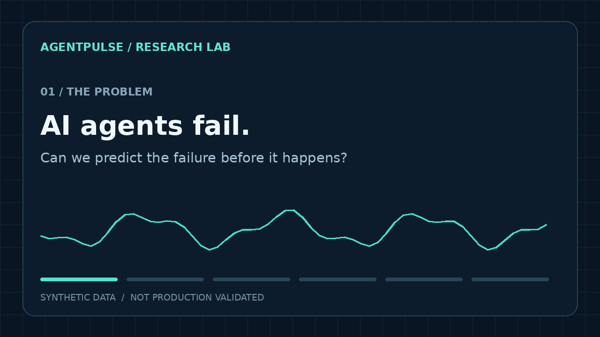
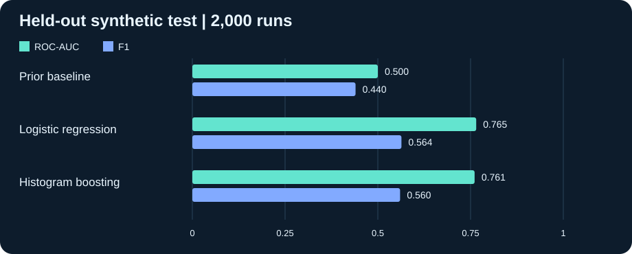
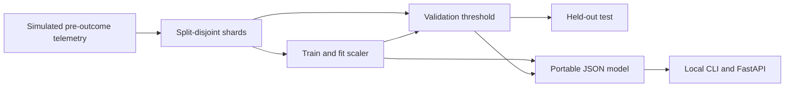

# AgentPulse-5G: AI agent failure prediction dataset & CPU model



**Can you predict an AI agent's failure before it finishes?** AgentPulse is a synthetic telemetry benchmark for AI agent reliability, observability and MLOps. It ships with runnable training code, a real fitted model and a no-prompt local risk predictor.

Created for **Zubair Hussain** · [GitHub](https://github.com/Zubair-hussain) · [Portfolio / work with me](https://zubairhussain.xyz)

  

## Watch the 30-second AgentPulse launch trailer

[](https://github.com/Zubair-hussain/AgentPulse-5G-AI-Agent-Failure-Prediction/blob/prod_core/assets/intro-saas.mp4)

[Watch or download the MP4 trailer](https://github.com/Zubair-hussain/AgentPulse-5G-AI-Agent-Failure-Prediction/raw/refs/heads/prod_core/assets/intro-saas.mp4) | text-led motion graphics and instrumental music. If GitHub does not show a player, open the download link.

The dashboard is illustrative. The benchmark is measured on held-out synthetic data.

Original narrated introduction: [WebM video](assets/intro.webm) | [captions / transcript](assets/intro.vtt).

## Repository and development

[GitHub repository](https://github.com/Zubair-hussain/AgentPulse-5G-AI-Agent-Failure-Prediction) | [Open issues](https://github.com/Zubair-hussain/AgentPulse-5G-AI-Agent-Failure-Prediction/issues) | [CI runs](https://github.com/Zubair-hussain/AgentPulse-5G-AI-Agent-Failure-Prediction/actions)

The default branch is `prod_core`. Open pull requests against that branch.

[](https://github.com/Zubair-hussain/AgentPulse-5G-AI-Agent-Failure-Prediction/actions/workflows/ci.yml)
[](https://github.com/Zubair-hussain/AgentPulse-5G-AI-Agent-Failure-Prediction/actions/workflows/release-check.yml)

CI validates data integrity, runs tests and inference on Python 3.11, 3.12 and 3.13, and checks offline publishing packages on pushes to `prod_core` and pull requests.

## What is included?
- **20,000** synthetic rows, 20 CSV shards, 16 model inputs, 36 possible environment cohorts; 16,000 train / 2,000 validation / 2,000 test.
- A reproducible generator targeting **5 GB** across 1,000 shards; full edition not included or executed in this ZIP. CSV and optional Parquet output.
- Three fitted benchmark baselines, a portable logistic model, and a separate streaming SGD model; no API keys or LLM inference required.
- Native Python predictor, FastAPI service, browser demo, Docker deployment, notebook, data/model cards, CI and tests.
- Original synthetic data only. Not production telemetry or a real-world performance claim.

## Measured demo benchmark



| Model | ROC-AUC | PR-AUC | F1 | Accuracy | Recall |
|---|---:|---:|---:|---:|---:|
| Prior baseline | 0.5000 | 0.2820 | 0.4399 | 0.2820 | 1.0000 |
| Logistic regression (shipped) | 0.7652 | 0.5859 | 0.5637 | 0.7190 | 0.6436 |
| Histogram gradient boosting | 0.7609 | 0.6059 | 0.5600 | 0.7030 | 0.6702 |

Validation selects the F1 threshold; test contains 2,000 independently generated runs from disjoint environment IDs and shifted rate limits. AUC measures ranking, not accuracy. Test positive rate: 28.2%. See [raw metrics](reports/benchmark.json), [streaming model metrics](reports/sgd.json) and [methodology](docs/methodology.md). The prior baseline deliberately predicts positive at its validation-selected threshold; compare ranking and F1, not accuracy alone.

## Quick start

Use Python 3.11–3.13. From the repository root:

```bash
python -m agentpulse.predict examples/telemetry.json
pip install -r requirements.txt
python -m tools.validate_data
python -m pytest -q
python -m agentpulse.train
```

Example result from the included model (rounded):

```json
{"failure_risk": 0.148168, "threshold": 0.30, "flagged": false}
```

Risk is a synthetic-model estimate, not a guaranteed future failure. The predictor accepts the 16 numerical fields in [telemetry.json](examples/telemetry.json), with no prompt.

## Architecture



## Generate the 5 GB edition

```bash
pip install -r requirements-publish.txt
python -m agentpulse.generate --out data/full-5gb --shards 1000 --target-gb 5 --format parquet
python -m tools.validate_data data/full-5gb
python -m agentpulse.stream_train --data data/full-5gb --out models/full-sgd.json --report reports/full-sgd.json
```

For CSV use `--format csv`. Size is estimated using a pilot, not guaranteed exact. Full data, Parquet generation and full-size performance are not verified in the build environment. See [full-scale guide](docs/full-scale.md), including real per-shard commits and Git LFS cautions.

## API and browser demo

```bash
pip install -r requirements-api.txt
uvicorn agentpulse.api:app --port 7860
```

Open http://localhost:7860 for the form or `/docs` for interactive API documentation. Use `/predict` with JSON. Docker: `docker build -t agentpulse .` then `docker run --rm -p 7860:7860 agentpulse`.

## Dataset card and file map
[Data dictionary](docs/data-dictionary.md) · [Data manifest](data/demo/manifest.json) · [Model card](publishing/hf-model/README.md) · [Dataset card template](publishing/hf-dataset/README.md) · [File catalog and commit messages](docs/file-catalog.md).

## Publishing and community
[Publication checklist](docs/publish.md) covers GitHub, GitLab, Hugging Face datasets/models/Docker Spaces and Kaggle datasets/notebooks. [Discoverability](docs/discoverability.md) includes natural keywords, topics and launch strategy. [Discussion drafts](community/discussion.md), [issues](community/roadmap.md), [contributing](CONTRIBUTING.md), [security](SECURITY.md) and [citation](CITATION.cff) are included. Hosted CI runs in GitHub Actions; public platform releases are tracked in the issue roadmap. The project name indicates the target data scale, not an existing 5 GB upload.

## Test cases and reproducibility
Run `python -m pytest -q`. Tests include deterministic generation, manifests and hashes, split isolation, feature leakage, numeric validation, inference, retraining and streaming. The notebook and offline staging were also executed locally. See [test output](reports/test-results.txt). No real-world accuracy is claimed; external validation, calibration and confidence intervals remain open issues.

## License & contact
MIT for original project files and synthetic data; dependencies retain their own licenses. See [LICENSE](LICENSE). For custom AI engineering, full-stack development, API integration or ML pipelines, [visit my portfolio](https://zubairhussain.xyz). Contributions and reproducible bug reports welcome.
